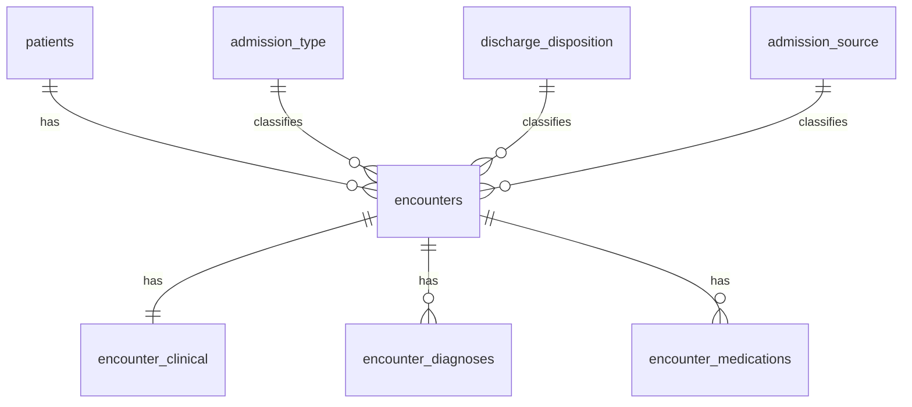

# Diabetes Hospital Readmissions: SQL Data Modeling and Quality Project

Cleaning, validating, and modeling 10 years of US hospital diabetes records in PostgreSQL, then using the model to study 30-day readmissions.

## Project goal

Turn one wide, messy CSV (101,766 rows x 50 columns) and a stacked lookup file into a clean, relational database, and use it to answer the question the dataset was built for: **which hospital stays end in early readmission (within 30 days)?**

**Skills shown:** PostgreSQL, data profiling, data cleaning, relational modeling, wide-to-long reshaping, CTEs, window functions, data validation.

## Dataset

| Item | Detail |
|---|---|
| Source | [UCI ML Repository: Diabetes 130-US Hospitals for Years 1999-2008](https://archive.ics.uci.edu/dataset/296/diabetes+130-us+hospitals+for+years+1999-2008) |
| Size | 101,766 hospital stays, 50 columns |
| Files | `diabetic_data.csv` (main data), `IDS_mapping.csv` (ID lookups) |
| Coverage | 130 US hospitals, 1999-2008, stays of 1-14 days |
| License | CC BY 4.0 |

## 1. Data understanding

- **One row = one hospital stay** (`encounter_id`), not one patient. A patient (`patient_nbr`) can appear many times.
- **Column groups:** patient (race, gender, age group), admission/discharge details (coded as IDs), clinical counts (lab tests, procedures, medications, prior visits), glucose and A1C test results, diagnoses (`diag_1` to `diag_3`, ICD-9 codes), 23 diabetes medication columns, and the target `readmitted` (`<30`, `>30`, `NO`).
- **Age is a range**, such as `[80-90)`, not an exact age.
- **`IDS_mapping.csv` is three tables stacked in one file** (admission type, discharge disposition, admission source), separated by blank lines.
- **Special value meanings:** `?` marks missing data. `None` in the glucose and A1C result columns means the test was not done, not that the value is missing.

## 2. Data quality assessment

Run on the staging table after loading, before any tables were built.

| Check | Result | Share of rows | Decision |
|---|---|---|---|
| Duplicate `encounter_id` | 0 | 0% | Safe to use as primary key |
| Missing `encounter_id` or `patient_nbr` | 0 | 0% | Keys are complete |
| `weight` missing | 98,569 | 96.9% | Excluded from model; too sparse to use |
| `medical_specialty` missing | 49,949 | 49.1% | Kept as NULL; labeled "Unknown" only when reporting |
| `payer_code` missing | 40,256 | 39.6% | Kept as NULL; labeled "Unknown" only when reporting |
| `race` missing | 2,273 | 2.2% | Kept as NULL |

Other issues found:
- `?` used as a missing-value marker across the file.
- Gender value `Unknown/Invalid` on a small number of rows.
- Several lookup IDs meaning "unknown" under different labels (`NULL`, `Not Available`, `Not Mapped`).
- A blank-line-separated lookup file that standard CSV import cannot read.
- Some discharge types (death, hospice) that make readmission impossible and would bias readmission rates.

## 3. Cleaning and transformation

1. **Staging load:** loaded all columns as text so no row fails on import.
2. **Standardized missing values:** trimmed whitespace; converted `?` and empty strings to NULL in all 50 columns.
3. **Invalid category:** set gender `Unknown/Invalid` to NULL.
4. **Clarified meaning:** renamed `None` to `Not tested` in the glucose and A1C result columns so it is not confused with missing data.
5. **Parsed the lookup file:** used a running header count (window function) to split the three stacked tables, then removed header lines and blank separators.
6. **Unified "unknown" labels** in the lookup tables to a single value.
7. **Normalized into tables** (see model below), including one row per patient using `DISTINCT ON`, preferring a stay where race is filled in.
8. **Wide to long:** turned `diag_1` to `diag_3` into rows with `UNION ALL`, and 23 medication columns into rows with `CROSS JOIN LATERAL (VALUES ...)`, keeping only drugs actually given.
9. **Type casting:** text to integers, bigint IDs, and a boolean for `diabetesMed`.
10. **Integrity checks:** orphan-ID checks on all three lookups before adding foreign keys, then row-count reconciliation.

## 4. Data model



| Table | Grain | Key |
|---|---|---|
| `patients` | one row per patient | `patient_nbr` |
| `encounters` | one row per stay | `encounter_id` |
| `encounter_clinical` | one row per stay | `encounter_id` |
| `encounter_diagnoses` | one row per stay and diagnosis order | (`encounter_id`, `diag_order`) |
| `encounter_medications` | one row per stay and drug given | (`encounter_id`, `drug_name`) |
| `admission_type`, `discharge_disposition`, `admission_source` | lookups | ID column |

Expected final counts: `encounters` and `encounter_clinical` = 101,766 each. Actual: `<fill in after running>`.

## 5. Analysis

**Important rule:** patients who died or went to hospice (discharge IDs 11, 13, 14, 19, 20, 21) cannot be readmitted, so they are excluded from readmission rates.

```sql
SELECT readmitted,
       count(*) AS stays,
       round(100.0 * count(*) / sum(count(*)) OVER (), 1) AS pct
FROM encounters
WHERE discharge_disposition_id NOT IN (11, 13, 14, 19, 20, 21)
GROUP BY readmitted
ORDER BY stays DESC;
```

Results: `<fill in: % of stays readmitted within 30 days>`

Further questions to explore:
- Readmission rate by age group (`age_start` extracted from the range).
- Readmission rate by discharge disposition and admission type.
- Days between a patient's consecutive stays (`LAG` over `patient_nbr`).
- Most common primary diagnoses and most-used medications.

## 6. Limitations

- Rows are stays, not patients; repeat patients are counted more than once.
- `weight`, `payer_code`, and `medical_specialty` are largely missing, so group comparisons on them cover only part of the data.
- Age is only available in 10-year ranges.
- Data covers 1999-2008 and may not reflect current practice.
- This is observational data, so results show association, not cause.

## 7. How to run

1. Create a PostgreSQL database.
2. Put `diabetic_data.csv` and `IDS_mapping.csv` in the folder you run `psql` from.
3. Run `diabetes_sql_setup.sql`.

## Citation

Strack B., DeShazo J., Gennings C., Olmo J., Ventura S., Cios K., Clore J. (2014). *Impact of HbA1c Measurement on Hospital Readmission Rates.* BioMed Research International. Dataset: Clore J., Cios K., DeShazo J., Strack B. (2014). UCI Machine Learning Repository, https://doi.org/10.24432/C5230J (CC BY 4.0).
